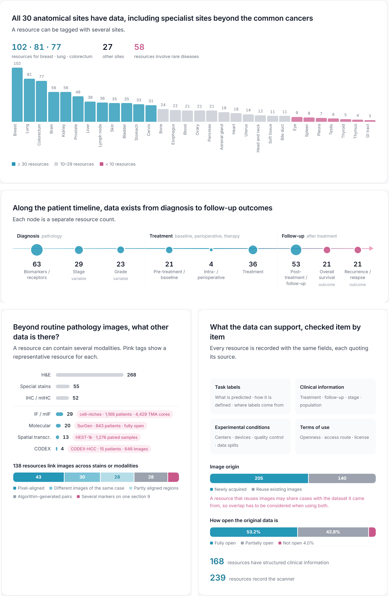

<p align="center">
  <a href="https://www.pathtrove.cn">
    <picture>
      <source media="(prefers-color-scheme: dark)" srcset="assets/readme/logo-dark.svg">
      
    </picture>
  </a>
</p>

<h3 align="center">Toward Ready-to-Use Clinical Data Services for Computational Pathology</h3>

<p align="center">
  PathTrove organizes pathology data resources, research papers and experiment-ready labels for AI and pathology researchers.
  It helps you find suitable data, check study conditions, and avoid repeating the work of downloading and organizing data.
</p>

<p align="center">
  <a href="https://www.pathtrove.cn"></a>
  <a href="https://aicarrier.feishu.cn/base/Ab7tb1c4VaxYIesGpnCchZkKn98?table=tblg0z31jVeg7WIh&view=vewLEEtCvC"></a>
  <a href="https://www.pathtrove.cn/ask.html"></a>
  <a href="https://www.pathtrove.cn/atlas.html"></a>
</p>

<p align="center"><b>English</b> · <a href="./README.zh-CN.md">中文</a></p>

## Start here: install the plugin and use PathTrove from your agent

The PathTrove plugin lets agents such as Claude Code and Codex read the resource table, resource reports, download guides and label files. Describe your need in your own words; the agent finds, compares and prepares data, and shows its evidence.

### 1. Install

**Claude Code**: type these two lines in Claude Code

```text
/plugin marketplace add DearCaat/PathTrove
/plugin install pathtrove@pathtrove
```

**Codex**: run in a terminal, then start a new Codex session

```bash
codex plugin marketplace add DearCaat/PathTrove
codex plugin add pathtrove@pathtrove
```

**Other MCP clients**: clone this repository, then add this to the client's MCP configuration with your clone path

```json
{"mcpServers": {"pathtrove": {"command": "python3", "args": ["/path/to/PathTrove/plugin/bin/pathtrove", "mcp"]}}}
```

- No account, key or server. Only `python3` on your machine.
- On first use it downloads a data package of about 14 MB from Hugging Face, verifies it and caches it locally. Your questions and searches stay on your machine.
- Plugin data version 2026.09.28: 352 resources, each with a resource report and a download guide; 108 have label files. Every answer states the data version.

### 2. Start your question with `/pathtrove` or `$pathtrove`

Put `/pathtrove` (Claude Code) or `$pathtrove` (Codex) before your question and the agent answers from PathTrove. Type `/pathtrove` or `$pathtrove` alone and it tells you what PathTrove can do.

Without the prefix, the agent usually uses PathTrove on its own when the question mentions pathology, WSIs or a dataset by name. A question that does not show its field, such as "a small dataset I can download right away to practise classification", may be answered from the model's own knowledge instead. To be sure PathTrove is used, add the prefix. Other MCP clients have no prefix; say "use PathTrove" in the question.

Start with these (in Codex, replace `/pathtrove` with `$pathtrove`):

```text
/pathtrove I work in computational pathology. How can you help me find datasets, and what can you do?
/pathtrove How many datasets are there per organ? How many of the breast ones are H&E?
/pathtrove I want to predict MSI status in colorectal cancer. Recommend 5 usable public WSI datasets, ideally with an external validation cohort.
/pathtrove Are there ready-made breast cancer label files with train/test splits by patient?
```

Prefer not to install anything? Browse and download each report, guide and label file on [Hugging Face](https://huggingface.co/datasets/Dearcat/PathTrove). The full plugin guide is [below](#plugin-guide).

## What PathTrove provides

<p align="center">
  
</p>

Search and feasibility studies are built on one evidence database: resource reports, data-source reports, paper reports, download guides and label files.

## What the database covers

Every entry is checked against its sources, from what was studied and what was measured to labels and clinical information.

<p align="center">
  
</p>

<p align="center"><a href="https://www.pathtrove.cn/atlas.html">Explore the full data atlas →</a></p>

## Reports, guides and labels

Five kinds of material take you from understanding a dataset to preparing an experiment.

> **Access Note**: The 2026.09.28 release is public, and no access request is needed. It includes the complete resource table, the resource reports and the download guides: browse them in the [Feishu table](https://aicarrier.feishu.cn/base/Ab7tb1c4VaxYIesGpnCchZkKn98?table=tblg0z31jVeg7WIh&view=vewLEEtCvC) (English view; [Chinese view](https://aicarrier.feishu.cn/base/Ab7tb1c4VaxYIesGpnCchZkKn98?table=tblCXoFxHiyF3fUm&view=vewLEEtCvC)), or get them through the plugin and the Hugging Face repository [`Dearcat/PathTrove`](https://huggingface.co/datasets/Dearcat/PathTrove). On Hugging Face, each resource's report, download guide and label files can also be browsed and downloaded one by one, without the plugin. Use of the data is governed by the [Research Use Terms](./TERMS_OF_USE.md).

| Material | What it records | Example |
| --- | --- | --- |
| **Resource report** · 352 | Content, labels, clinical information and the source behind each of 38 fields | [CRC-MSI (TCGA-CRC-DX)](./examples/TCGA-CRC-DX_report.en.md) |
| **Data-source report** · 11 sources (not in this public release) | How an upstream platform such as TCGA, CPTAC, HTAN or GTEx organizes projects, cases and files, and how to get access | [TCGA](./examples/TCGA_source_report.en.md) |
| **Paper report** · 106 studies (not in this public release) | How a study used its data, task by task: inputs and outputs, data roles, splits and evidence | [NePSTA (*Nature Cancer*, 2025)](./examples/NePSTA_paper_report.en.md) |
| **Download guide** · 352 | Official files, access conditions and download steps | [Ovarian-Bevacizumab-Response (TCIA)](./examples/Ovarian-Bev_download_guide.en.md) |
| **Label file** · 302 files for 108 resources | Samples matched to task labels and experiment splits | [Ovarian bevacizumab response (JSON)](./examples/Ovarian-Bev_label.json) |

> Representative examples for each material type are in the GitHub [`examples/`](./examples/) directory; they show the formats (schema design, task framing, provenance structure). The complete 2026.09.28 release (resource table, resource reports, download guides and label files) is public as described above. Paper reports and data-source reports are not in this release yet. When primary sources disagree, PathTrove faithfully preserves both accounts and quotes the underlying evidence.

## From a research need to experiment-ready data

Turning a clinical research question into benchmarked, model-ready data is rarely straightforward. Researchers often face ill-defined evaluation setups, multi-condition filtering across scattered metadata, unverified source contradictions, and high-friction data access.

PathTrove bridges the gap from research needs to experiment-ready data through a systematic, database-backed workflow:

1. **Task Deconstruction & Feasibility Check** (*Paper reports*)  
   Starting from an overarching clinical question (such as treatment response prediction, molecular subtyping, or survival risk modeling), peer-reviewed paper reports reveal how prior studies framed tasks, defined inputs/outputs, and benchmarked models. This grounds the research setup in proven precedents and clarifies whether public data can realistically support the evaluation before investing engineering effort.
2. **Multi-condition Screening & Cohort Matching** (*Database & Resource reports*)  
   Using structured filters across 38+ metadata fields—spanning 30 anatomical sites, staining modalities, scanner specifications, and clinical variables (such as stage, grade, therapy regimens, and follow-up endpoints)—researchers pinpoint suitable candidate resources. The database clarifies cohort sizes and data roles to design sound internal training/validation sets alongside independent external validation cohorts.
3. **Source-backed Evidence & Quality Audit** (*Evidence statements*)  
   Public datasets frequently suffer from conflicting counts, vague label definitions, or mismatched sample identifiers. Every critical field in PathTrove is linked directly to verbatim source citations from papers, data portals, and release manifests. By preserving conflicting claims rather than smoothing them over, the database allows researchers to spot data traps and ambiguities before data processing begins.
4. **Acquisition & Ready-to-Use Label Integration** (*Download guides & Label files*)  
   Download guides provide verified acquisition paths from official repositories, detailing access permissions and tested network routing. Corresponding standardized label files then deliver sample-level targets, task definitions, and leak-free patient splits in clean, machine-readable JSON, allowing researchers to plug data directly into training pipelines.

## Plugin guide

The `pathtrove` plugin lets agents such as Claude Code and Codex answer questions from PathTrove's curated resource tables, reports and label files. Ask in plain language: the agent searches PathTrove, reads the reports, and answers with the evidence it found and the data version it used.

### What you can ask

| Question (examples in their original language) | What the agent does |
| --- | --- |
| 我想做结直肠癌 MSI 状态预测，推荐 5 个能用的公开 WSI 数据集，最好能分出外部验证队列。 | Filters colorectal WSI resources, finds the MSI evidence in their reports, opens each candidate report, and returns 5 datasets with cohort size, label source, access route and a train / external-validation plan. Near misses are listed separately. |
| CAMELYON16 要申请吗？有多大？怎么下载？ | Reads access conditions, license, size and download routes from the report and the download guide. If a number is not recorded, it says so instead of guessing. |
| 现在收录的数据里，按器官分各有多少个数据集？乳腺的里面 H&E 的有多少？ | Counts rows of the resource table by organ and by staining, and gives the exact numbers. |
| 有没有现成的、按患者划分好训练/测试的乳腺癌标注文件？ | Finds breast cancer label files, with their official splits and the text that explains each split. |
| 帮我把 Ovarian-Bevacizumab-Response 的标注文件下到 ./labels。 | Downloads that label file into `./labels` and checks its sha256. |
| Find public WSI datasets with paired frozen-section and FFPE slides of the same cases. | Searches PathTrove first. For the gaps it searches the web and lists those results separately as "not in PathTrove, not curated". |

### Install and first use

The install commands are at the [top of this page](#start-here-install-the-plugin-and-use-pathtrove-from-your-agent).

- **Requirements**: `python3` on the PATH. The plugin uses only the Python standard library (tested with Python 3.10). Nothing else to install.
- **First use**: the plugin downloads the data package for release `2026.09.28` (about 14 MB) from the public Hugging Face repository [`Dearcat/PathTrove`](https://huggingface.co/datasets/Dearcat/PathTrove), checks its sha256 against the plugin manifest, and caches it for later use.

### What the plugin gives the agent

| Area | What the agent can do |
| --- | --- |
| Table | Search the resource table by field, words or conditions, list the fields, and get counts. |
| Report | Open one resource report, or search across all reports. Each field can be read as its value, its text or its source. |
| Download | Check how to get a resource: access status and license, the download guide by section, the downloadable objects and their sizes as the guide describes them, and the record of a download test. |
| Label | See which resources have label files (filter by organ or split), list one resource's files, and fetch one file with a sha256 check. |
| Best data | Turn a research need into recommended datasets: analyse the need, make hard conditions into filters, start broad, judge on report evidence, and respect the number asked for. |

Every answer states the data version. `pathtrove version` shows it.

Every resource has a permanent PTD id, such as `PTD-000001`. The plugin shows it in the id column of the resource table and of label results, and the Hugging Face repository uses it to name each resource folder.

### How it works and privacy

- **Data stays on your machine.** The plugin reads its local cache. It sends no question, query or personal data to any server. Its only network access is downloading the data package and the label files you ask for, both from Hugging Face.
- **Web search is the agent's choice, not the plugin's.** If the agent has web tools, it may use them for a question PathTrove cannot answer. The policy the agent is given: PathTrove first; go outside only to fill coverage gaps; label anything found outside as not curated by PathTrove.
- **To forbid outside search**, set `PATHTROVE_WEB=off`. The plugin can only tell the agent this setting; it cannot switch off the client's own web tools.

### Settings

| Variable | Values (default) | What it does |
| --- | --- | --- |
| `PATHTROVE_LANG` | `zh`, `en` (`zh`) | Output language when a command or tool gets no `lang` argument. The agent answers in the language the user writes in. |
| `PATHTROVE_WEB` | `on`, `off` (`on`) | `off` tells the agent not to search outside PathTrove. |
| `PATHTROVE_HOME` | a directory (`~/.cache/pathtrove`) | Where the data package is cached. |
| `HF_ENDPOINT` | a URL (`https://huggingface.co`) | Hugging Face host. Behind a firewall, use a mirror such as `https://hf-mirror.com`. |
| `HTTPS_PROXY` | a URL (none) | Proxy for downloading the data package and label files, such as `http://127.0.0.1:7890`. |

- **Offline install**: on a machine with access, download the archive named in `plugin/data-manifest.json` (its file name, size and sha256 are listed there), copy it over, and run `pathtrove data install --file <archive>`. The archive is checked against the manifest before it is installed.
- **Label files** are large (302 files, 8.4 GB in all) and are not in the data package. `pathtrove label fetch` downloads one file at a time from the same repository and checks its sha256.

### Codex and other MCP clients

- **Codex**: install the plugin with the two commands above. It brings the PathTrove skills and the MCP server, and approves its own tools, so `codex exec` needs no extra setting. Start questions with `$pathtrove`.
- **Other MCP clients**: the plugin is a stdio MCP server. After cloning this repository, register `python3 <clone>/plugin/bin/pathtrove mcp` as a server (configuration above). These clients do not get the PathTrove skills, so say "use PathTrove" in the question.
- **Command line**: the same commands work in a shell as `python3 plugin/bin/pathtrove <domain> <verb>` (`--help` lists them).

### Limits

- Records can contain errors. Check any value that matters for a decision against the primary source the report cites.
- Coverage is this release only (2026.09.28, 352 resources). Paper reports and data-source reports are not in it, and a resource missing here may still exist.
- Answers are written by the model you run, from the PathTrove data. They can be wrong, so check the cited report before you rely on an answer.
- Use of the data is governed by the [Research Use Terms](./TERMS_OF_USE.md).

## Using PathTrove responsibly

1. Use the table and reports to find resources that may fit your study.
2. Check decision-critical claims against the cited primary sources.
3. Confirm the current license, terms, access procedure and data version with the original provider.

PathTrove does not host or redistribute pathology data. It does not endorse the listed resources, and their providers do not endorse PathTrove. Listing a resource grants no access or reuse rights, and PathTrove is not medical advice. See the [Research Use Terms](./TERMS_OF_USE.md) for details.

## Citation

If you find PathTrove useful for your research, please consider starring our repository ⭐ and citing our work:

PathTrove does not have a formal peer-reviewed publication yet. Until the paper is published, please cite the project as follows, and include the access date (the database and reports are updated continuously):

```text
PathTrove Contributors. PathTrove: Toward Ready-to-Use Clinical Data Services for Computational Pathology. https://github.com/DearCaat/PathTrove. Accessed YYYY-MM-DD.
```

```bibtex
@misc{pathtrove2026,
  title        = {PathTrove: Toward Ready-to-Use Clinical Data Services for Computational Pathology},
  author       = {Wenhao Tang and Yu Li and Yubin Zhang and Xiangyu Ran and Yiyang Su and Jin Li and Xiang Li and Fang Yan and Ming-Ming Cheng and Yirong Chen},
  year         = {2026},
  howpublished = {\url{https://www.pathtrove.cn}},
  note         = {Accessed: YYYY-MM-DD}
}
```

Machine-readable metadata are in [`CITATION.cff`](./CITATION.cff).

## Corrections

Please report errors through [GitHub Issues](https://github.com/DearCaat/PathTrove/issues). Include the resource name, the affected field, the current and proposed values, and a primary source URL with its access date. Submissions are checked against the evidence before they are incorporated.

## License

- Documentation and website material authored for this repository: [CC BY 4.0](./LICENSE).
- The PathTrove table, reports, label files and other curated resources: [PathTrove Research Use Terms](./TERMS_OF_USE.md). Non-commercial research use is permitted; commercial use, and redistributing all or a substantial part, need prior permission.
- Third-party datasets, papers, names and logos remain under their own rights and terms.

<p align="center"><sub>Maintained by Nankai University and Shanghai AI Laboratory · © 2026 PathTrove Team</sub></p>
