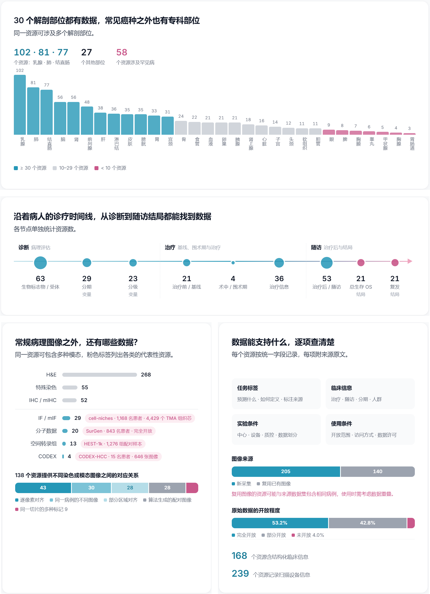

<p align="center">
  <a href="https://www.pathtrove.cn">
    <picture>
      <source media="(prefers-color-scheme: dark)" srcset="assets/readme/logo-dark.svg">
      
    </picture>
  </a>
</p>

<h3 align="center">从临床研究需求，到开箱即用的病理数据</h3>

<p align="center">
  PathTrove 为 AI 与病理研究者整理数据资源、研究论文和实验所需的标签。帮助你找到合适的数据、核对研究条件，减少下载与整理数据的重复工作。
</p>

<p align="center">
  <a href="https://www.pathtrove.cn"></a>
  <a href="https://aicarrier.feishu.cn/base/Ab7tb1c4VaxYIesGpnCchZkKn98?table=tblCXoFxHiyF3fUm&view=vewLEEtCvC"></a>
  <a href="https://www.pathtrove.cn/ask.html"></a>
  <a href="https://www.pathtrove.cn/atlas.html"></a>
</p>

<p align="center"><a href="./README.md">English</a> · <b>中文</b></p>

## 先装插件，在你的 agent 里使用 PathTrove

PathTrove 插件让 Claude Code、Codex 等 agent 直接读取资源表、资源报告、下载指南和标签文件。你用自己的话描述需求，agent 查找、比较、准备数据，并说明依据。

### 1. 安装

**Claude Code**：在 Claude Code 里依次输入

```text
/plugin marketplace add DearCaat/PathTrove
/plugin install pathtrove@pathtrove
```

**Codex**：在终端运行，然后新开一个 Codex 会话

```bash
codex plugin marketplace add DearCaat/PathTrove
codex plugin add pathtrove@pathtrove
```

**其他 MCP 客户端**：克隆本仓库，把下面这段加入客户端的 MCP 配置，路径换成你的克隆位置

```json
{"mcpServers": {"pathtrove": {"command": "python3", "args": ["/path/to/PathTrove/plugin/bin/pathtrove", "mcp"]}}}
```

- 不需要账号、key 或服务器，只需本机有 `python3`。
- 第一次使用时从 Hugging Face 下载约 14 MB 数据包，校验后缓存在本机；你的问题和检索都在本机完成。
- 插件数据版本 2026.09.28：352 个资源，每个附资源报告与下载指南；108 个资源有标签文件。每个回答都会注明数据版本。

### 2. 用 `/pathtrove` 或 `$pathtrove` 开头提问

在问题前加上 `/pathtrove`（Claude Code）或 `$pathtrove`（Codex），agent 就会用 PathTrove 回答。只输入 `/pathtrove` 或 `$pathtrove`，它会介绍 PathTrove 能做什么。

不加前缀时，问题里提到病理、WSI、某个数据集等，agent 通常也会自己用 PathTrove；但像“找个能直接下载的小数据集练手”这样看不出领域的问题，它可能不用 PathTrove，直接凭自己的知识回答。想确保用上 PathTrove，就加前缀。其他 MCP 客户端没有这两个前缀，请在问题里写明“用 PathTrove”。

可以先问这几句（Codex 把 `/pathtrove` 换成 `$pathtrove`）：

```text
/pathtrove 我在做计算病理，你这边有什么办法帮我找数据集？能做到哪些事？
/pathtrove 现在收录的数据里，按器官分各有多少个数据集？乳腺的里面 H&E 的有多少？
/pathtrove 我想做结直肠癌 MSI 状态预测，推荐 5 个能用的公开 WSI 数据集，最好能分出外部验证队列。
/pathtrove 有没有现成的、按患者划分好训练/测试的乳腺癌标注文件？
```

不想装插件，也可以直接在 [Hugging Face](https://huggingface.co/datasets/Dearcat/PathTrove) 上逐个浏览和下载报告、指南与标签文件。插件的完整说明见[下文](#插件详细说明)。

## PathTrove 提供什么

<p align="center">
  
</p>

检索与可行性研究都建立在同一套循证数据库上：资源报告、数据源报告、论文报告、下载指南和标签文件。

## 数据库覆盖

从研究对象、数据模态到标签与临床信息，逐项核对来源。

<p align="center">
  
</p>

<p align="center"><a href="https://www.pathtrove.cn/atlas.html">查看完整数据版图 →</a></p>

## 报告、指南与标签

五类材料，从读懂数据，到准备实验。

> **访问说明**：2026.09.28 版本已全面公开，无需申请访问权限。公开内容包括完整的资源表格、资源报告和下载指南：可在[飞书表格](https://aicarrier.feishu.cn/base/Ab7tb1c4VaxYIesGpnCchZkKn98?table=tblCXoFxHiyF3fUm&view=vewLEEtCvC)中查阅（英文视图见[此处](https://aicarrier.feishu.cn/base/Ab7tb1c4VaxYIesGpnCchZkKn98?table=tblg0z31jVeg7WIh&view=vewLEEtCvC)），也可通过插件及 Hugging Face 公开仓库 [`Dearcat/PathTrove`](https://huggingface.co/datasets/Dearcat/PathTrove) 获取；在 Hugging Face 上，每个资源的报告、下载指南和标签文件也可以逐个浏览和下载，无需安装插件。数据使用须遵守 [PathTrove 科研使用条款](./TERMS_OF_USE.md)。

| 材料 | 记录什么 | 示例 |
| --- | --- | --- |
| **资源报告** · 352 份 | 内容、标签、临床信息与来源依据，共 38 个字段，每个字段附来源原文 | [CRC-MSI（TCGA-CRC-DX）](./examples/TCGA-CRC-DX_report.md) |
| **数据源报告** · 11 个数据源（不在本次公开版本中） | TCGA、CPTAC、HTAN、GTEx 等上游平台的项目组成、病例与文件关系，以及获取条件 | [TCGA](./examples/TCGA_source_report.md) |
| **论文报告** · 106 篇论文（不在本次公开版本中） | 按任务还原论文的数据用法：输入输出、数据角色、划分方式与证据来源 | [NePSTA（*Nature Cancer*，2025）](./examples/NePSTA_paper_report.md) |
| **下载指南** · 352 份 | 官方文件、访问条件与下载步骤 | [Ovarian-Bevacizumab-Response（TCIA）](./examples/Ovarian-Bev_download_guide.md) |
| **标签文件** · 302 个文件，108 个资源 | 对应样本、任务标签与实验划分 | [卵巢癌贝伐珠单抗疗效（JSON）](./examples/Ovarian-Bev_label.json) |

> 各类材料的代表性样例已收录在 GitHub [`examples/`](./examples/) 目录中，主要展示规范、数据架构与任务组织形式。样例展示的是格式；完整的 2026.09.28 版本（资源表格、资源报告、下载指南和标签文件）已如上公开，论文报告和数据源报告暂未包含在本版本中。当一手来源之间存在口径冲突时，PathTrove 如实保留双方口径并注明依据。

## 从研究需求到实验数据

把一个临床或病理科研设想推进到可在 GPU 上运行的实验数据，往往面临多重阻碍：宏观的研究构想难以快速拆解为严谨的机器学习任务、多维严苛的研究条件在海量碎片化数据中极难匹配、公开数据的元数据与标签常存口径冲突，而下载受阻与繁琐的数据清洗更耗费大量精力。

PathTrove 通过一套系统的循证数据库与配套材料，打通从“研究需求”到“实验就绪数据”的全流程支撑：

1. **任务拆解与可行性论证**（依托论文报告）  
   从宏观的临床问题（如特定药物敏感性预测、分子亚型分型或生存预后评估）出发，结合收录的同行论文报告，梳理既往研究的数据用法、任务定义、输入输出规格与基准表现。借此将研究设想落到切实可评价的任务上，并在动手前判断公开数据是否足以支撑、是否存在关键队列缺口。
2. **多维条件检索与队列规划**（依托数据库与资源报告）  
   围绕研究设想在器官部位、疾病亚型、染色模态、扫描仪设备以及临床变量（如分期、分级、用药、随访结局）上的多重约束，在 352 个资源与 30 个解剖部位中精准初筛；核对各个资源的样本规模与入组边界，合理规划内部训练集、内部验证集与独立外部验证队列。
3. **一手证据核查与口径对齐**（依托字段级来源语句）  
   公开数据集常存在切片与患者混淆、标签定义模糊或不同来源记载矛盾。PathTrove 为关键字段保留论文原文、官方页面或元数据清单的一手引述；当来源之间存在矛盾时如实保留双方口径并说明理由，帮助研究者在进入实验前排查潜在陷阱，避免因口径错误导致研究返工。
4. **合规实测获取与标签开箱即用**（依托下载指南与标签文件）  
   依据经过中国大陆网络实测的下载指南，从官方渠道合规、高效地获取原始图像与元数据；直接使用由确定性脚本整理的标准任务级标签文件，样本标识、任务标签与严防数据泄漏的患者级实验划分（Train / Val / Test）一一对应，程序可直接读取加载，直接进入模型训练与评估。

## 插件详细说明

`pathtrove` 插件让 Claude Code、Codex 等 agent 直接回答 PathTrove 中的问题，依据是经过整理的资源表格、资源报告和标签文件。用自然语言提问即可：智能体会检索 PathTrove、阅读报告，并给出证据和所用的数据版本。

### 可以问什么

| 问题（示例保持原文） | 智能体会做什么 |
| --- | --- |
| 我想做结直肠癌 MSI 状态预测，推荐 5 个能用的公开 WSI 数据集，最好能分出外部验证队列。 | 筛选结直肠癌的 WSI 资源，在报告中查找 MSI 相关证据，逐个打开候选报告，返回 5 个数据集，并给出队列规模、标签来源、获取途径，以及训练与外部验证队列的划分方案。接近但不符合条件的资源单独列出。 |
| CAMELYON16 要申请吗？有多大？怎么下载？ | 从报告和下载指南中读取访问条件、许可证、大小和下载途径。报告里没有记录的数字会直接说明，不会猜测。 |
| 现在收录的数据里，按器官分各有多少个数据集？乳腺的里面 H&E 的有多少？ | 按器官和染色方式统计资源表格的行数，给出准确数字。 |
| 有没有现成的、按患者划分好训练/测试的乳腺癌标注文件？ | 找出乳腺癌的标签文件，列出其划分（训练、验证、测试）以及划分依据的原文。 |
| 帮我把 Ovarian-Bevacizumab-Response 的标注文件下到 ./labels。 | 把该标签文件下载到 `./labels`，并校验 sha256。 |
| Find public WSI datasets with paired frozen-section and FFPE slides of the same cases. | 先在 PathTrove 中检索；对缺口再到网上检索，结果单独列出，标注为“不在 PathTrove 中，未经整理”。 |

### 安装与首次使用

安装命令见[开头](#先装插件在你的-agent-里使用-pathtrove)。

- **依赖**：PATH 中有 `python3` 即可。插件只使用 Python 标准库（已在 Python 3.10 上测试），无需安装其他东西。
- **首次使用**：插件从 Hugging Face 公开仓库 [`Dearcat/PathTrove`](https://huggingface.co/datasets/Dearcat/PathTrove) 下载版本 `2026.09.28` 的数据包（约 14 MB），按插件清单校验 sha256，然后缓存到本地供之后使用。

### 插件给智能体提供什么

| 范围 | 智能体能做什么 |
| --- | --- |
| 表格 | 按字段、关键词或条件检索资源表格，列出字段，统计数字。 |
| 报告 | 打开某个资源的报告，或跨所有报告检索。每个字段可按取值、原文或来源查看。 |
| 下载 | 查看如何获取资源：访问状态与许可证，按章节列出的下载指南，指南所述的可下载对象及大小，以及下载测试记录。 |
| 标签 | 查看哪些资源有标签文件（可按器官或划分过滤），列出某个资源的文件，按 sha256 校验后取回其中一个文件。 |
| 最佳数据 | 把研究需求落到推荐数据集：分析需求，把硬条件变成过滤条件，先宽后窄，依据报告证据判断，并遵守用户要求的数量。 |

每个回答都会注明数据版本，可用 `pathtrove version` 查看。

每个资源都有永久编号 PTD，如 `PTD-000001`。插件在资源表格和标签结果的 id 列中显示它，Hugging Face 仓库也用它为每个资源目录命名。

### 工作方式与隐私

- **数据留在本机。** 插件读取本地缓存。插件不会把问题、查询或个人信息发送到任何服务器；它的网络访问只有两项：下载数据包，以及下载你要求的标签文件，二者都来自 Hugging Face。
- **联网检索由智能体决定，而非插件。** 如果智能体有联网工具，它可能用于 PathTrove 无法回答的问题。给智能体的策略是：先用 PathTrove；只为补足覆盖缺口才到外部检索；从外部找到的内容标注为未经 PathTrove 整理。
- **要禁止外部检索**，设置 `PATHTROVE_WEB=off`。插件只能把这一设置告知智能体，无法关闭客户端自身的联网工具。

### 设置

| 环境变量 | 取值（默认） | 作用 |
| --- | --- | --- |
| `PATHTROVE_LANG` | `zh`、`en`（`zh`） | 命令或工具未指定 `lang` 参数时的输出语言。智能体会按用户书写的语言作答。 |
| `PATHTROVE_WEB` | `on`、`off`（`on`） | 设为 `off` 时，告知智能体不在 PathTrove 之外检索。 |
| `PATHTROVE_HOME` | 目录（`~/.cache/pathtrove`） | 数据包的缓存位置。 |
| `HF_ENDPOINT` | 网址（`https://huggingface.co`） | Hugging Face 地址。在防火墙后可改用镜像，如 `https://hf-mirror.com`。 |
| `HTTPS_PROXY` | 网址（无） | 下载数据包和标签文件时使用的代理，如 `http://127.0.0.1:7890`。 |

- **离线安装**：在能联网的机器上下载 `plugin/data-manifest.json` 中写明的压缩包（清单里有其文件名、大小和 sha256），拷贝过来后运行 `pathtrove data install --file <压缩包>`。安装前会先按清单校验。
- **标签文件**体积较大（302 个文件，合计 8.4 GB），不在数据包中。`pathtrove label fetch` 每次从同一仓库下载一个文件，并校验 sha256。

### Codex 与其他 MCP 客户端

- **Codex**：按上面的两条命令安装插件。插件带有 PathTrove 的技能和 MCP 服务器，并已声明放行自己的工具，`codex exec` 也无需额外设置。用 `$pathtrove` 开头提问。
- **其他 MCP 客户端**：插件本身是一个 stdio MCP 服务器。克隆本仓库后，把 `python3 <克隆目录>/plugin/bin/pathtrove mcp` 注册为服务器（配置见上文）。这些客户端没有 PathTrove 的技能说明，提问时请写明“用 PathTrove”。
- **命令行**：同样的命令也可以在 shell 里用 `python3 plugin/bin/pathtrove <domain> <verb>` 运行（`--help` 列出全部命令）。

### 局限

- 记录可能有错误。对影响决策的数值，请回到报告引用的一手来源核实。
- 覆盖仅限本版本（2026.09.28，352 个资源）。论文报告和数据源报告不在本版本中；本版没有的资源仍可能存在。
- 回答由你所用的模型根据 PathTrove 数据生成，可能出错；依赖回答之前请核对所引用的报告。
- 数据使用须遵守 [PathTrove 科研使用条款](./TERMS_OF_USE.md)。

## 负责任地使用

1. 用表格和报告找出可能适合研究的资源。
2. 对影响研究决策的内容，回到所引用的一手来源核验。
3. 向原始提供方确认当前的许可证、使用条款、访问流程和数据版本。

PathTrove 不托管、不分发病理数据；不为所收录资源背书，这些资源的提供方也不为 PathTrove 背书。收录某项资源不代表因此获得访问或复用权，PathTrove 也不构成医疗建议。详见 [PathTrove 科研使用条款](./TERMS_OF_USE.md)。

## 引用

如果觉得 PathTrove 对你的研究有帮助，十分欢迎引用我们的工作，也欢迎在 GitHub 上给我们点一个 ⭐️ Star！

PathTrove 尚无正式发表的期刊/会议论文。在正式论文发表前，请按以下格式引用本项目，并注明访问日期（表格和报告会持续更新）：

```text
PathTrove Contributors. PathTrove: Toward Ready-to-Use Clinical Data Services for Computational Pathology. https://github.com/DearCaat/PathTrove. Accessed YYYY-MM-DD.
```

```bibtex
@misc{pathtrove2026,
  title        = {PathTrove: Toward Ready-to-Use Clinical Data Services for Computational Pathology},
  author       = {Wenhao Tang and Yu Li and Yubin Zhang and Xiangyu Ran and Yiyang Su and Jin Li and Xiang Li and Fang Yan and Ming-Ming Cheng and Yirong Chen},
  year         = {2026},
  howpublished = {\url{https://www.pathtrove.cn}},
  note         = {Accessed: YYYY-MM-DD}
}
```

机器可读的引用信息见 [`CITATION.cff`](./CITATION.cff)。

## 报告错误

欢迎通过 [GitHub Issues](https://github.com/DearCaat/PathTrove/issues) 提交修正，请写明资源名称、涉及字段、当前与建议的内容，以及一手来源链接和访问日期。提交内容会依据证据核查后再决定是否纳入。

## 许可

- 本仓库原创的项目文档和网站材料：[CC BY 4.0](./LICENSE)。
- PathTrove 表格、报告、标签文件及其他整理资源：[PathTrove 科研使用条款](./TERMS_OF_USE.md)。允许非商业科研使用；商业使用以及对全部或实质部分的二次分发，须事先取得许可。
- 第三方数据集、论文、名称和 Logo 仍受各自权利和条款约束。

<p align="center"><sub>维护机构：南开大学与上海人工智能实验室 · © 2026 PathTrove Team</sub></p>
